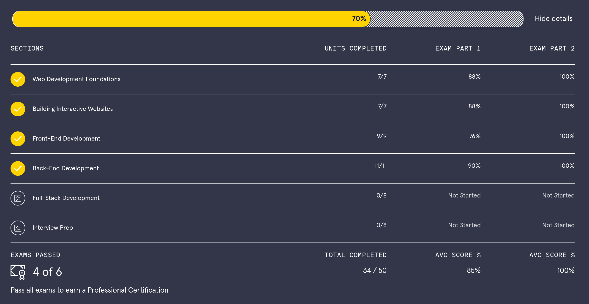

# Codecademy
As part of my learning, I have been completing Codecademy courses. My progress can be seen on my [Codecademy profile](https://www.codecademy.com/profiles/hevolx).

As I've worked through the courses, the challenges have grown more complex. I've chosen to keep each solution in its own repository, and this page collects links to all of them. It also links to my portfolio projects. These are larger projects where I get more freedom in how I build things, and they let me apply what I've learned so far.

My current progress on the full-stack engineer path is shown below (as at 14 Nov 2026).

## Challanges
* **Web Development Foundations**
    - [HTML & CSS Cheatsheet](https://github.com/hevolx/html-css-cheatsheet) - exploring & explaining colour referencing
    - [Build a Website Design System](https://github.com/hevolx/Build-a-Website-Design-System) - creating a style guide for creating websites
    - [Company Home Page with Flexbox](https://github.com/hevolx/Company-Home-Page-with-Flexbox) - using flexbox to design and build the layout for a company’s homepage
    - [Responsive Club Website](https://github.com/hevolx/Responsive-Club-Website) - building a page that will dynamically respond as you adjust the size of your screen
* **Building Interactive Websites**
    - [Number Guesser](https://github.com/hevolx/numberGuesser) - try to guess as close to the secret target number. Playing against a robot.
    - [Credit Card Checker](https://github.com/hevolx/Credit-Card-Checker) - validates credit card numbers with the Luhn algorithm
    - [Mysterious Organism](https://github.com/hevolx/mysterious-organism) - using java functions to find the mysterious organism
* **Front-End Development** 
    - [Appointment Planner](https://github.com/hevolx/Appointment-Planner) - React components to create an app that manages contacts and appointments
    - [Flashcards](https://github.com/hevolx/flashcards) - React application for creating and managing flashcards organized into topics and quizzes.
* **Back-End Development**
    - [Find Your Hat](https://github.com/hevolx/find-your-hat) - An interactive terminal game
    - [Boss Machine](https://github.com/hevolx/Boss-Machine) - An REST API-driven management application for today's most successful (evil) entrepreneurs
    - [Quote API](https://github.com/hevolx/quote-api) - Uses Express.js to build a small JSON API to serve up famous and interesting quotes about technology
* **Full-Stack Development**
    - *Currently pursuing*

## Portfolio projects
* [Mixed Messages](https://github.com/hevolx/message-generator) - Node.js console app that generates random messages each time a user runs the program and version your project with Git/GitHub
* [Personal Portfoilio Website](https://www.loveholmgren.com) - A website to showcase my progress so far, incorporating what I have learnt so far.
* [Jammming](https://github.com/hevolx/Jammming) - A Playlist App With the Spotify API
* [Reddit Client](https://github.com/hevolx/Reddit-Client) - A Reddit clone using the Reddit API
* [Create an E-Commerce App](https://github.com/hevolx/e-commerce-app) - A e-commerce REST API using Node/Express and PostgreSQL